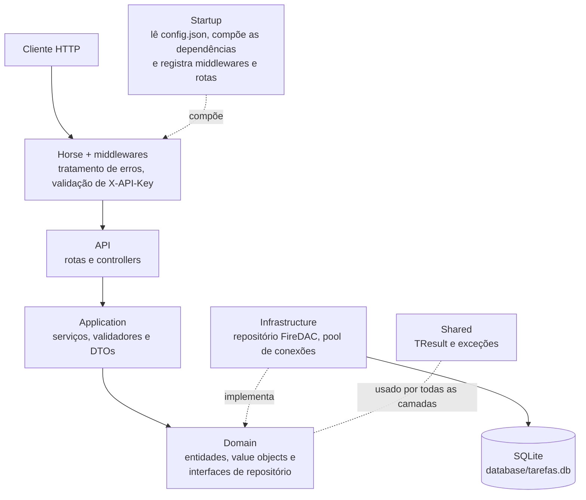
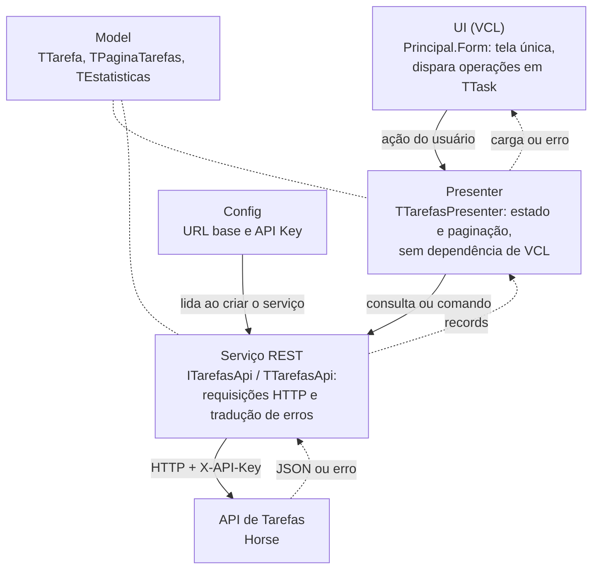

# Tarefas

Sistema de gerenciamento de tarefas em Delphi 13, composto por uma **API REST** e um **cliente VCL** que a consome.

- **API**: criar, listar, atualizar status, remover e consultar estatísticas de tarefas. Usa o framework [Horse](https://github.com/HashLoad/horse), SQLite com FireDAC e Clean Architecture.
- **Cliente VCL**: aplicação de tela única, sem persistência local, que usa somente a API.

## Sumário

- [Visão geral](#visão-geral)
- [Pré-requisitos](#pré-requisitos)
- [Como executar](#como-executar)
- [Configuração](#configuração)
- [API](#api)
- [Cliente VCL](#cliente-vcl)
- [Testes](#testes)
- [Estrutura do repositório](#estrutura-do-repositório)

## Visão geral

### Arquitetura da API

A requisição desce da camada HTTP até o banco; as dependências apontam para o Domain.



### Arquitetura do cliente

O cliente segue o padrão Presenter: a tela não fala HTTP nem guarda estado de paginação.



## Pré-requisitos

- **Delphi 13 (RAD Studio)** para compilar e executar os projetos. O FireDAC já inclui o driver SQLite.
- **[Boss](https://github.com/HashLoad/boss)** para baixar o Horse em `modules/` (somente a API).

Não é preciso preparar o banco: ao iniciar, a API cria o arquivo SQLite (`database/tarefas.db`) e a tabela `Tarefas` caso ainda não existam.

> Se você já tem um `database/tarefas.db` de uma versão anterior do projeto, apague-o para que seja recriado com o schema atual (a coluna `Responsavel` passou a ser obrigatória).

## Como executar

1. Baixe as dependências, na raiz do projeto:

   ```sh
   boss install
   ```

2. Crie o `config.json` (ignorado pelo Git) a partir do modelo e defina sua chave em `api.apiKey`:

   ```sh
   cp config.example.json config.json
   ```

3. Abra `api/Tarefas.API.dproj` no Delphi 13, compile (Build) e execute (F9). A API sobe em `http://localhost:9000`.

4. Teste:

   ```sh
   curl -H "X-API-Key: SUA_CHAVE" http://localhost:9000/api/tarefas
   ```

5. Para usar o cliente, abra `app/Tarefas.App.dproj`, compile e execute (F9) com a API em execução.

A API e o cliente procuram o `config.json` subindo as pastas a partir do executável, então o arquivo da raiz é encontrado sem cópia. O caminho do banco é relativo à pasta do `config.json`.

## Configuração

Arquivo `config.json`, na raiz do projeto:

| Chave | Padrão | Uso |
| --- | --- | --- |
| `database.file` | `database/tarefas.db` | Arquivo SQLite |
| `api.port` | `9000` | Porta HTTP |
| `api.host` | `0.0.0.0` | Interface de escuta (`127.0.0.1` aceita só conexões locais) |
| `api.apiKey` | *(sem padrão)* | Valor aceito no header `X-API-Key`. Obrigatória: a API não inicia sem ela. Também pode vir da variável `TAREFAS_API_KEY` |
| `api.environment` | `development` | Nome do ambiente |
| `pagination.defaultLimit` / `maxLimit` | `10` / `100` | Padrão e teto do `limit` da listagem, aplicados pelo serviço |

## API

### Endpoints

Todas as rotas exigem o header `X-API-Key`; sem ele a API responde 401 (`API_KEY_AUSENTE` ou `API_KEY_INVALIDA`).

| Método | Rota | Descrição |
| --- | --- | --- |
| GET | `/api/tarefas` | Lista com `limit` e `offset` |
| GET | `/api/tarefas/:id` | Busca uma tarefa |
| POST | `/api/tarefas` | Cria; corpo `titulo`, `responsavel` (obrigatório, até 100), `descricao`, `prioridade` (1 = Baixa, 2 = Média, 3 = Alta) e `dataPrevisaoFinalizacao` (opcional, `yyyy-mm-dd` ou `yyyy-mm-dd hh:nn:ss`; formato inválido retorna 400 `DATA_PREVISAO_INVALIDA`) |
| PUT | `/api/tarefas/:id` | Atualiza o status: `Pendente`, `Em Progresso` ou `Concluída` |
| DELETE | `/api/tarefas/:id` | Remove |
| GET | `/api/tarefas/stats/resumo` | Total, média de prioridade e concluídas nos últimos 7 dias |

Exemplo:

```sh
curl -X POST http://localhost:9000/api/tarefas \
  -H "X-API-Key: SUA_CHAVE" \
  -H "Content-Type: application/json" \
  -d '{"titulo":"Estudar Delphi","descricao":"Clean Architecture","prioridade":3,"responsavel":"Ana","dataPrevisaoFinalizacao":"2030-01-15"}'
```

### Comportamento

- Erros inesperados do servidor retornam 500 com a mensagem genérica "Erro interno do servidor"; o detalhe vai só para o console da API.
- Uma `prioridade` presente mas não inteira (texto, `null`, `2.5`) retorna 400 `PRIORIDADE_INVALIDA`; só a chave ausente assume 1.
- Repetir `PUT` com `Concluída` numa tarefa já concluída mantém a data de finalização original.

### Swagger / OpenAPI

Com a API rodando, abra `http://localhost:9000/docs` (Swagger UI) e use o botão **Authorize** para informar a `X-API-Key`. A especificação OpenAPI 3 está em `http://localhost:9000/openapi.json`. As duas rotas são públicas.

A especificação fica em `api/openapi.json`, lida do disco na inicialização (procurada a partir da pasta do executável subindo os diretórios, como o `config.json`). Ao criar ou alterar endpoints, edite esse arquivo e reinicie a API. A interface carrega os arquivos do Swagger UI via CDN (jsDelivr), então o navegador precisa de acesso à internet.

## Cliente VCL

Aplicação VCL de tela única que usa **somente** a API. Usa `REST.Client` da própria RTL; não precisa de Boss nem de componentes de terceiros.

### Recursos

- **Estatísticas** no topo: total de tarefas, média de prioridade das pendentes e concluídas nos últimos 7 dias.
- **Nova tarefa**: título (até 100), descrição (até 500), prioridade Baixa, Média ou Alta, responsável (obrigatório) e previsão de finalização. A previsão já vem marcada com amanhã (hoje + 1 dia); desmarcar a caixa cria a tarefa sem previsão.
- **Lista** paginada (10/25/50/100 por página), com status colorido.
- **Atualizar status** da tarefa selecionada: Pendente, Em Progresso ou Concluída.
- **Remover** com confirmação (tecla Del).
- **F5** recarrega. O rodapé mostra a URL da API e se ela está acessível.

### Configuração do cliente

A URL e a API Key vêm do `config.json` da raiz. Sem o arquivo, a URL padrão é `http://localhost:9000`; a API Key não tem padrão e precisa vir do `config.json` ou da variável `TAREFAS_API_KEY`. A variável `TAREFAS_API_URL` sobrescreve a URL.

### Comportamento

- A tela fala com um presenter (`TTarefasPresenter`, sem VCL), que usa `ITarefasApi`.
- As chamadas HTTP rodam em `TTask` e o resultado é aplicado na thread principal. A janela não fecha enquanto há requisição em andamento.
- Título e responsável vazios são validados na tela antes de chamar a API. Os demais limites (100, 500, prioridade de 1 a 3) são apenas dicas de interface; a API é a validadora.
- Erros de validação da API (`TITULO_*`, `DESCRICAO_*`, `PRIORIDADE_*`, `RESPONSAVEL_*`, `DATA_PREVISAO_*`) levam o foco ao campo correspondente.
- Respostas HTTP 5xx mostram o erro real da API; somente a falta de resposta (timeout de 10 s ou conexão recusada) é exibida como "API indisponível" e marca o rodapé como Desconectado.

### Estrutura do cliente

| Caminho | Conteúdo |
| --- | --- |
| `app/src/Config` | Leitura de URL e API Key |
| `app/src/Model` | Records da tarefa, página e estatísticas; nomes de prioridade; leitura de datas da API |
| `app/src/Service` | `ITarefasApi` / `TTarefasApi`: chamadas REST e tradução de erros |
| `app/src/Presenter` | `TTarefasPresenter`: limite, deslocamento, página atual, regra de página vazia e texto de paginação |
| `app/src/UI` | Tela principal (`Principal.Form`) |

## Testes

Os testes usam DUnitX e são executados pelo IDE.

O projeto `api/tests/Tarefas.API.Tests.dproj` cobre domínio, serviços, validadores e `TResult`, com fake de repositório. Os testes de controller são HTTP: exigem a API rodando (`http://localhost:9000` ou a variável `TAREFAS_API_URL`); sem servidor, terminam como PULADO.

Para detectar vazamentos de memória, o projeto ativa `ReportMemoryLeaksOnShutdown`: feche a API ou o runner normalmente para ver o relatório.

## Estrutura do repositório

| Caminho | Conteúdo |
| --- | --- |
| `api/src/Shared` | Resultado (`TResult`, sem status HTTP) e exceções |
| `api/src/Domain` | Entidades, value objects e interfaces de repositório |
| `api/src/Application` | Serviços, DTOs (requisições e respostas em records) e validadores |
| `api/src/Infrastructure` | Conexão SQLite/FireDAC (pool) e repositório |
| `api/src/API` | Controllers, rotas, middlewares, validador de API Key e formatador de respostas |
| `api/src/Startup` | Configuração, composição das dependências (serviço, repositório, validador) e inicialização |
| `api/openapi.json` | Especificação OpenAPI servida em `/openapi.json` |
| `api/tests` | Testes DUnitX da API |
| `app/` | Cliente VCL (`Tarefas.App.dproj`) |
| `database/` | Arquivo SQLite criado pela API ao iniciar (`tarefas.db`), ignorado pelo Git |
| `modules/` | Dependências do Boss (Horse), ignorado pelo Git |
| `config.json` | Porta, host, API Key, caminho do banco e paginação. Contém a chave, por isso é ignorado pelo Git |
| `config.example.json` | Modelo do `config.json`, sem chave real |
| `boss.json` | Dependências (Horse `^3.3.16`) |
